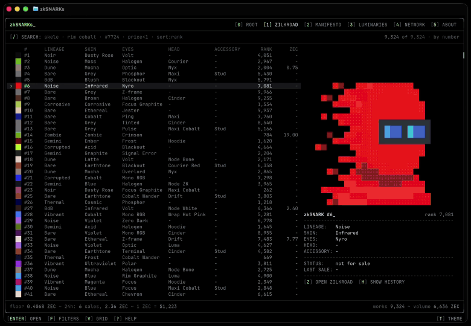

# zkSNARKs CLI

> This is a community project, not affiliated with the zkSNARKs team or Zilkroad.\
> Built by [@noisebody0x](https://x.com/noisebody0x) for ZECATHON 2026.



This is a terminal explorer for the zkSNARKs collection and the Zilkroad market.

All 10,000 artworks are drawn in block characters and ship inside the app. You can search by trait, price and rarity, and follow new listings, bids and trades as they happen.

Browsing happens locally, so the app never tells a server which token you are looking at. The only requests are public, collection-wide market data from zilkroad.com.

A medium this limited leaves a lot of room for creativity. In the 90s I set up my first BBS and joined the community of people using those systems to create and distribute digital art. Moving zkSNARKs into the terminal feels like bringing them home.

## Install

### macOS and Linux

Open a terminal, paste this and press Enter:

```sh
curl -fsSL https://raw.githubusercontent.com/dangerous-person/zksnarks-cli/main/install.sh | sh
```

It picks the right build for your computer, checks the download and installs `zksnarks` into `/usr/local/bin`.
If it asks for your password, that is to write into `/usr/local/bin`; nothing shows while you type.
Then start it:

```sh
zksnarks
```

### Windows

1. Download `zksnarks-windows-amd64.zip` from [Releases](https://github.com/dangerous-person/zksnarks-cli/releases/latest).
2. Unzip it.
3. Open Windows Terminal or PowerShell in that folder and run `.\zksnarks.exe`.

If Windows says "Windows protected your PC", click More info, then Run anyway.
It asks because the app is not signed.

### Manual install

| Your computer | File |
|---|---|
| Mac with Apple silicon (M1 and later) | `zksnarks-darwin-arm64.tar.gz` |
| Mac with Intel | `zksnarks-darwin-amd64.tar.gz` |
| Linux on x86-64 | `zksnarks-linux-amd64.tar.gz` |
| Linux on 64-bit ARM, such as a Raspberry Pi 4 or 5 | `zksnarks-linux-arm64.tar.gz` |
| Alpine, or Linux with no sound | `zksnarks-linux-amd64-no-audio.tar.gz` or `zksnarks-linux-arm64-no-audio.tar.gz` |
| Windows | `zksnarks-windows-amd64.zip` |

Unpack it into its own folder and move `zksnarks` to a folder on your PATH.
Use your file's name in place of the Mac one below:

```sh
mkdir zksnarks-files
tar -xzf zksnarks-darwin-arm64.tar.gz -C zksnarks-files
sudo mkdir -p /usr/local/bin
sudo mv zksnarks-files/zksnarks /usr/local/bin/
```

If your browser already unpacked it, the program is in a folder named like the file:

```sh
sudo mkdir -p /usr/local/bin
sudo mv ~/Downloads/zksnarks-darwin-arm64/zksnarks /usr/local/bin/
```

On macOS, a file downloaded in the browser is blocked the first time it runs.
Allow it once in System Settings, Privacy & Security, or run:

```sh
xattr -d com.apple.quarantine /usr/local/bin/zksnarks
```

### With Go

With Go 1.26 or newer:

```sh
go install github.com/dangerous-person/zksnarks-cli/cmd/zksnarks@latest
```

### Ask your AI agent

Paste this into any AI agent that can use your terminal:

> Install zksnarks from github.com/dangerous-person/zksnarks-cli

## Update and uninstall

Run the install command again to update.
To uninstall, delete the program and its settings:

```sh
sudo rm /usr/local/bin/zksnarks
rm -rf ~/.config/zksnarks
```

## Commands

Run `zksnarks` on its own to open the explorer, or with a command to print right in your terminal:

```sh
zksnarks            # launch explorer
zksnarks 7724       # print the card of zkSNARK #7724
zksnarks random     # print the card of a random zkSNARK
zksnarks bids       # print the zkSNARKs with active bids
zksnarks sales      # print the latest sales
zksnarks version    # print the version
zksnarks help       # show this help
```

## Keys

| Key | Does |
|---|---|
| `0` to `5` | root, zilkroad, manifesto, luminaries, network, about |
| `/` | search |
| `↑` `↓` `←` `→` | move |
| `Enter` | open, play, read |
| `Esc` | back, close |
| `F` | filters |
| `V` | grid or list |
| `+` `-` | bigger or smaller art in the list |
| `Z` | open the zkSNARK on Zilkroad |
| `H` | its history |
| `R` | retry when Zilkroad can't be reached |
| `T` | theme |
| `?` | search help |
| `Q` | quit |

## Search

Press `/` in the explorer and type what you are looking for:

| Type | Finds |
|---|---|
| `skele` | a trait, by first letters |
| `skele rim` | more traits, all must match |
| `eyes:"rim cobalt"` | one trait, exact value |
| `lineage:noise,dune` | one trait, this or that |
| `#7724` or `#7724 #12` | one zkSNARK, or a few |
| `listed` | for sale now |
| `price<1.5` | under 1.5 ZEC |
| `last>2` | last sold over 2 |
| `rank<=100` | the 100 rarest |
| `purged` | burnt |
| `unlisted`, `apparition`, `auction` | other statuses |
| `sort:price` | cheapest first |
| `sort:-price` | priciest first |
| `sort:rank` | rarest first |
| `sort:new` | newest listings |
| `sort:number` | by number |
| `skele sort:rank` | mix any of these |

Press `?` in the explorer for the same list.

## Privacy

- All 10,000 artworks ship inside the program, so browsing never tells a server which zkSNARKs you look at.
- The only traffic is public market data for the whole collection from zilkroad.com: prices, stats and the ZEC rate.
- The one exception is a zkSNARK's history: pressing `H` asks Zilkroad for that one token.
- No account, no wallet, no telemetry.
- `zksnarks -offline` makes no network requests at all; prices then come from the build.

## Terminal

- Any modern terminal works: Ghostty, iTerm2, WezTerm, kitty, Terminal.app, Windows Terminal.
- For the best experience use Ghostty or iTerm2 on a Mac: they draw the art's blocks themselves, Terminal.app takes them from your font.
- On a Mac it needs macOS 13 or later.
- The window needs at least 80x24, and 120x40 or bigger looks best.
- Terminals with 24-bit colour show the art exactly; others get the closest of 256 colours.
- If the art looks striped, try `zksnarks -glyph five-eighths`.
- On Linux, sound plays through PulseAudio, PipeWire or ALSA; without them the app stays silent.

## Sound over SSH

Over SSH, zksnarks runs on the server, so you hear nothing.
To hear it, start a sound server on your own computer and let SSH carry the sound back to it.

On a Mac, install PulseAudio with [Homebrew](https://brew.sh) and start it:

```sh
brew install pulseaudio
pulseaudio -D -n --exit-idle-time=-1 \
  -L "module-coreaudio-detect record=no" \
  -L module-suspend-on-idle \
  -L "module-native-protocol-tcp port=4713 listen=127.0.0.1 auth-ip-acl=127.0.0.1"
```

It prints a warning about capabilities, which you can ignore.
The `record=no` part leaves your microphone out.

On Linux, PipeWire or PulseAudio is usually running already, so one command is enough:

```sh
pactl load-module module-native-protocol-tcp port=4713 listen=127.0.0.1 auth-ip-acl=127.0.0.1
```

Connect to the server with the sound tunnel:

```sh
ssh -R 4713:127.0.0.1:4713 you@your-server
```

Then start zksnarks on the server:

```sh
PULSE_SERVER=tcp:127.0.0.1:4713 zksnarks
```

- The sound is smooth up to about 30 ms ping to the server.
- Only do this with a server you alone use: while you are connected, others on it can reach your sound server, and on Linux your microphone.
- To stop the sound server, run `pulseaudio -k` on a Mac or `pactl unload-module module-native-protocol-tcp` on Linux.

## Credits

The artwork is the zkSNARKs collection.
The manifesto, luminaries and network texts come from [zksnarks.net](https://zksnarks.net).
Market data comes from [zilkroad.com](https://zilkroad.com).

Special thanks to Erythh for letting me use "Can't Sleep at Night":
[erythh.bandcamp.com/album/aishiteru](https://erythh.bandcamp.com/album/aishiteru)\
[youtube.com/channel/UCynkQpYpfgK0mxgPdwZGTcg](https://www.youtube.com/channel/UCynkQpYpfgK0mxgPdwZGTcg)

## License

The code is MIT licensed, see [LICENSE](LICENSE).
The artwork, the zksnarks.net texts, the interviews and the music belong to their authors and are not covered by the MIT license.
Licenses of the libraries the app uses are in [THIRD_PARTY_NOTICES.md](THIRD_PARTY_NOTICES.md).


